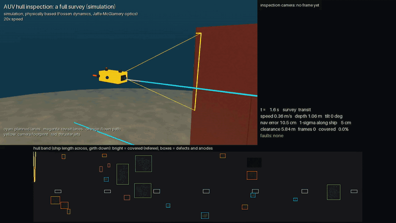
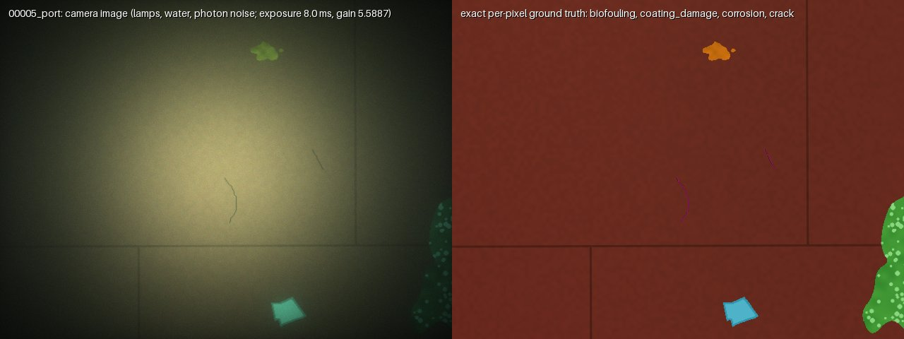
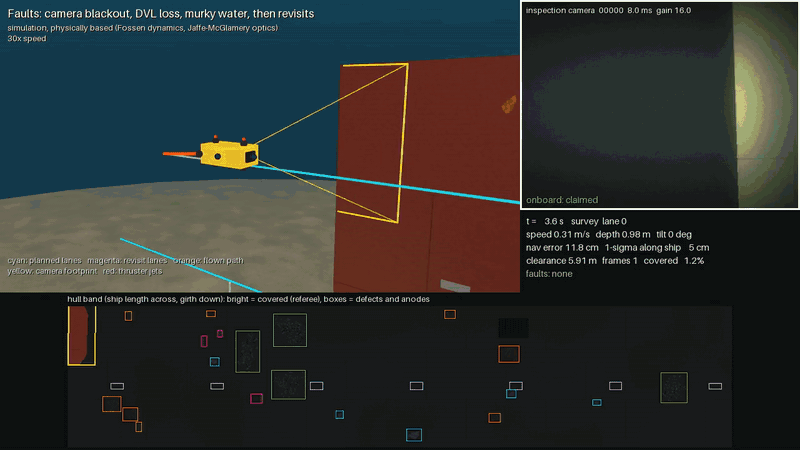
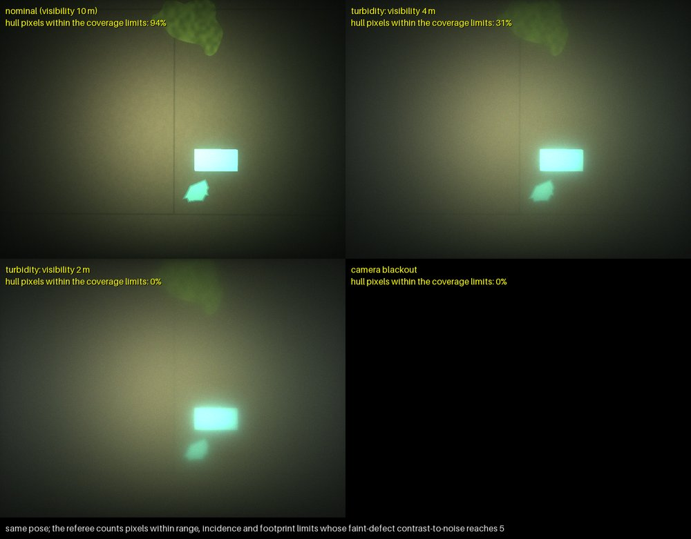
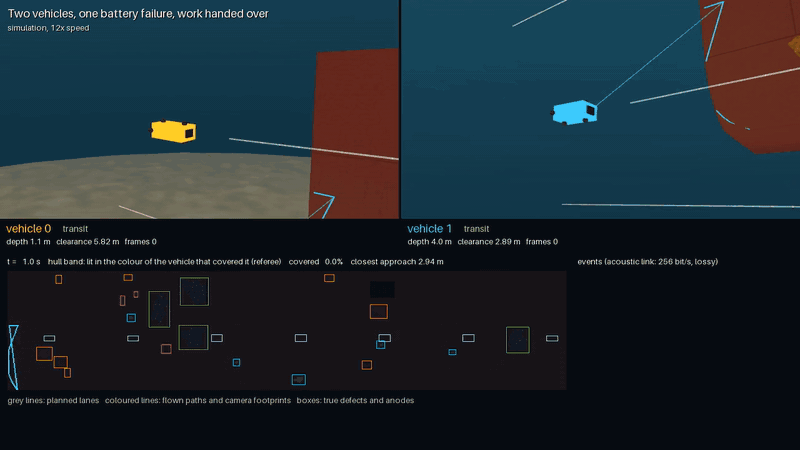
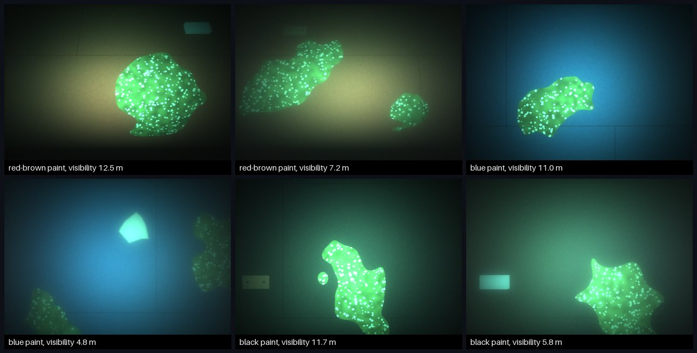
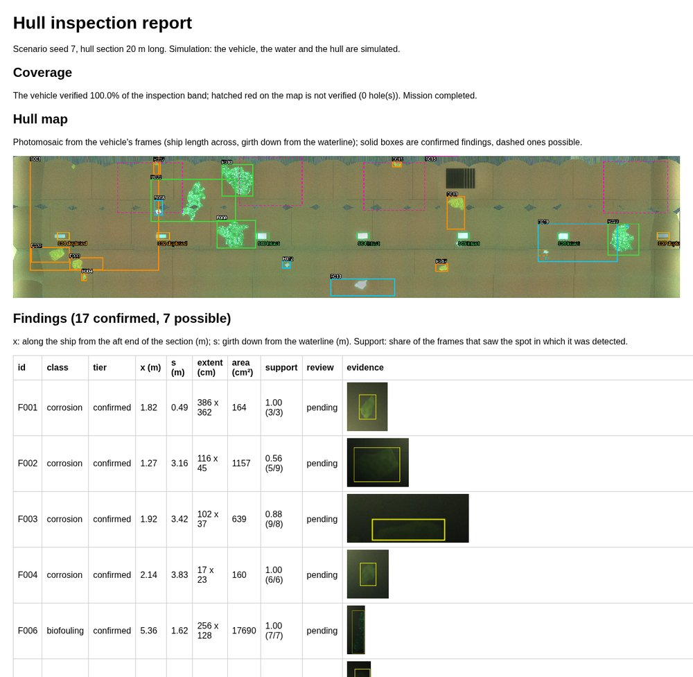
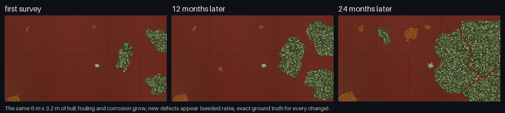
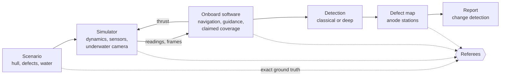

# AUV Hull Inspection

[](https://github.com/MadLad10/auv_inspection/actions/workflows/ci.yml)

Software for an autonomous underwater vehicle that inspects a ship's hull: it plans the survey,
flies it, finds corrosion, coating damage, fouling, cracks and worn anodes, and writes an
inspection report. Everything is built and tested in simulation, where every defect is known
exactly, so every claim the software makes can be checked.



*A full survey of a 20 m hull section at 20× speed. Top left: the vehicle on its lanes, with its
camera footprint. Top right: each camera frame and the vehicle's own verdict on it. Bottom: the
hull lighting up as the referee counts it covered, with the true defects boxed.
[Full video, 5× speed (MP4)](docs/media/survey.mp4)*

## Why simulation

Real inspection footage has no ground truth. Nobody knows exactly where every defect is, how big
it is, or whether the vehicle really saw every part of the hull. Here the world is generated from
a seed, so all of that is known, down to which defect each camera pixel shows. Independent
referees score coverage, detections, the defect map and the fleet against that truth, never
against what the software reports about itself.



## What it does

- **Hull scenarios.** Seeded hull sections with plates, weld seams, a sea-chest grating and
  anodes, and five defect types. Real defects cut from the
  [LIACi](https://liaci.sintef.cloud) inspection images can be painted on instead of procedural ones.
- **Underwater images from physics.** MuJoCo renders the geometry; a Jaffe-McGlamery light model
  adds the lamps, absorption, forward scatter and backscatter, and a photon-counting camera adds
  exposure, noise and motion blur.
- **Vehicle in the loop.** Fossen 6-DOF dynamics with added mass and contact; IMU, DVL, depth and
  compass fused by an EKF, with position fixes from the hull's ends; ten injectable faults;
  revisits to fill coverage holes; an abort that climbs clear of the hull on low battery.
- **Perception.** A classical detector, a small learned region classifier (numpy), and a deep
  segmenter (ImageNet-pretrained MobileNetV2 with an FPN decoder, PyTorch), scored on simulated
  hulls and on real images.
- **Defect map and report.** Detections projected onto the hull and confirmed across views, anode
  stations checked against the hull plan, an HTML report with a photomosaic and inspector review,
  and change detection between surveys months apart.
- **Fleet.** Several vehicles share one hull over a slow, lossy acoustic link. A coordinator on the
  ship hands an aborted vehicle's work to another, and safety rules keep the vehicles apart.
- **Production layer.** Benchmark suites that gate every change in CI, a container image, a model
  registry that tracks licences, and observability: an event stream, Prometheus metrics, traces
  and alert rules.

## See it run

### Faults and recovery

The camera goes dark for 25 s, the DVL drops out for 60 s, and the water turns murky (2 m
visibility) for 20 s. The vehicle marks the frames it cannot verify, so after the survey it claims
85.5% of the hull while the referee counts 94.7%. It then plans and flies revisit lanes over the
holes and ends at 100%, with no false claims and no contact with the hull.



[Full video, 6× speed (MP4)](docs/media/faults.mp4)



*One camera pose in clear water, in murky water and with a dead camera. The share of hull pixels
the referee counts drops from 94% to 31% to nothing.*

### Two vehicles, one battery failure

Vehicle 1's battery fails 100 s in. It moves clear of the hull and climbs to the surface. The
topside on the ship hears the abort over the acoustic link 6 s later. When vehicle 0 has finished
its own lanes, the topside hands it vehicle 1's unflown lane. The hull ends 100% covered (89.5%
without coordination), and the vehicles never come closer than 2.79 m.



[Full video, 6× speed (MP4)](docs/media/fleet.mp4)

### Varied water and paint

Each benchmark hull draws its water clarity and one of three antifouling paints from its seed.
These frames come from the frozen test suite:



### The inspection report

The report is a photomosaic of the hull built from the vehicle's frames, with the findings boxed.
It adds a table of findings with evidence crops, the anode stations' status and the vehicle's
health log. An inspector marks each finding confirmed or rejected, and an appendix scores
everything against the ground truth.



### The same hull, months later

The simulator ages a hull at configured rates. Change detection compares two surveys and labels
each finding new, grown, unchanged or gone.



## How it fits together



The onboard software never reads the scenario: it sees only sensor readings, its own commands and
the hull drawings, as a real vehicle would. The referees see everything.

## Results

These are simulation results and say nothing about performance on a real hull. The first four
rows are pooled over a frozen test suite of 8 hulls never used for tuning (three paints, water
visibility 4.8 to 12.5 m), with 95% intervals from resampling hulls. The LIACi row uses LIACi's
own test split; the fault and fleet rows come from single hulls.

| Measure | Result |
|---|---|
| Hull coverage | 100% on every test hull; the vehicle never claimed coverage it did not get |
| Anode stations (intact, depleted or missing) | 55 of 56 right; all 9 missing anodes found |
| Procedural defects, region classifier | 86% found (79–92%) at 98% precision; 0.25 false findings per hull |
| Real LIACi defects painted on, deep segmenter | 70% found (65–76%) at 68% precision; the classical detector finds 16% |
| Real LIACi test images, deep segmenter | 0.29 mean pixel IoU over corrosion, coating damage, fouling and anodes |
| Faults (blackout, turbidity, DVL loss, stuck sensors, dead thruster) | no false coverage claims; revisits restore 100% after blackout, turbidity and a 60 s DVL loss |
| Fleet on a 20 m hull | 2.0× faster with 2 vehicles, 4.0× with 4; after a battery failure, 100% coverage (89.5% without coordination) |

Details and the runs behind each number are in [docs](#documentation).

## Quick start

Linux with Python 3.10 and [uv](https://docs.astral.sh/uv/). Rendering is headless.

```bash
git clone https://github.com/MadLad10/auv_inspection.git && cd auv_inspection
uv venv .venv --python 3.10
uv pip install --python .venv/bin/python -c constraints.txt -e ".[dev]"   # ".[dev,learn]" adds CPU PyTorch
export MUJOCO_GL=egl

.venv/bin/auvinspect generate --seed 7 --out runs/s7                    # a hull with seeded defects
.venv/bin/auvinspect mission  --scenario runs/s7 --out runs/s7/mission  # fly the survey (a few minutes)
.venv/bin/auvinspect report   --run runs/s7/mission --out runs/s7/report  # defect map and report.html
```

Or in the container:

```bash
docker build -t auvinspect .
docker run --rm -v "$PWD/runs:/work/runs" auvinspect benchmark run --suite ci --out runs/bench/ci
```

Run the tests (about 11 minutes):

```bash
env -u PYTHONPATH MUJOCO_GL=egl .venv/bin/python -m pytest -q
```

Every other command (fleets, faults, datasets, training, benchmarks, the registry) is in
[docs/usage.md](docs/usage.md).

## Design

- **Ground truth comes from the world, never from a model.** Coverage, detections, the map and
  the fleet are scored against the scenario.
- **Simulator, onboard software and referee are separate.** The vehicle's software works only
  from what a real vehicle could know, and `Vehicle.step(thrust)` is the only path to the
  thrusters.
- **Deterministic.** Every random draw comes from a named stream, so the same seed and
  configuration give the same scenario digest, images and trajectories on a given renderer.
- **No magic numbers.** Physical, sensor and sampling constants live in
  [`default.yaml`](src/auvinspect/config/default.yaml) and are validated on load.
- **World and run are separate.** A scenario is frozen with a digest; missions with different
  settings and faults fly over the same world.

| Area | Modules in [`src/auvinspect`](src/auvinspect) |
|---|---|
| World | `scenario`, `hull`, `texture`, `patches`, `evolution` |
| Simulator | `scene`, `render`, `optics`, `camera`, `vehicle`, `dynamics`, `sensors`, `faults` |
| Planning and onboard software | `planner`, `predict`, `guidance`, `onboard`, `survey`, `mission` |
| Perception | `baseline`, `detector`, `segmenter`, `dataset`, `liaci` |
| Map and report | `mapping`, `stations`, `report`, `change` |
| Fleet | `fleet`, `acoustics` |
| Referees | `coverage`, `perception` |
| Production | `benchmark`, `registry`, `observe`, `config`, `rng`, `cli` |

## Milestones

All six are complete.

1. Scenarios, rendering, survey planning and the coverage referee
2. Vehicle in the loop: dynamics, navigation drift, faults, replanning
3. Perception: datasets, classical and learned detectors, real LIACi images, the deep segmenter
4. Defect map, anode stations, inspection report, change detection
5. Production layer: benchmark gate in CI, container, model registry, observability, fault injection
6. Fleet: several vehicles sharing a hull under acoustic communication limits

## Documentation

| Page | Contents |
|---|---|
| [Simulated world](docs/simulation.md) | Scenarios, ground truth, the light and camera models, the coverage criterion, vehicle dynamics |
| [Vehicle in the loop](docs/mission.md) | Navigation, guidance and control, faults, onboard health checks, claimed coverage, replanning |
| [Perception](docs/perception.md) | Datasets, the classical detector and region classifier, LIACi real images, real defects in the simulator, the deep segmenter |
| [Defect map and report](docs/mapping.md) | Placing and confirming findings, anode stations, the report, change detection |
| [Fleet](docs/fleet.md) | Sharing the hull, the acoustic link, coordination and safety rules, positioning from the ship |
| [Benchmark, CI and operations](docs/production.md) | Benchmark suites and gate, test-suite results, model registry, observability, container |
| [Usage](docs/usage.md) | Every command |
| [Output files](docs/outputs.md) | What each run writes |
| [Tests](docs/testing.md) | What the tests check |
| [Limitations](docs/limitations.md) | The full list |

## Limitations

- **Simulation only.** No result here has been checked on a real vehicle or hull.
- **The sim-to-real gap is real.** A segmenter trained only on simulated hulls scores 0.03 to 0.05
  pixel IoU on LIACi's real images; real images had to be part of training.
- **The deep segmenter is noisy.** It makes about 5 false confirmed findings per test hull. Its
  weights are trained on LIACi-derived data and cannot be distributed, so CI does not cover it.
- **Cracks are hard.** Cracks 3 to 6 mm wide sit at the camera's resolution; the classical
  pipeline finds 23% of them, the deep segmenter 8 to 10 of 13.
- **Simplified physics.** Single scattering, Lambertian surfaces, uniform water, no waves or
  hull wall effect; the acoustic channel ignores multipath.
- **Bit-identical results only on one renderer.** A GPU and the software renderer give slightly
  different photon-noise draws, so scores move within the noise.

## Data and licences

[LIACi](https://liaci.sintef.cloud) is licensed CC BY-NC-SA 4.0 and is not part of this
repository. Real-defect patches, hulls painted with them, and models trained on either stay out of
the repository and CI. If you use it, cite:

> M. Waszak, A. Cardaillac, B. Elvesæter, F. Rødølen, M. Ludvigsen, "Semantic Segmentation in
> Underwater Ship Inspections: Benchmark and Data Set", *IEEE Journal of Oceanic Engineering*
> 48(2), 462-473, 2023. doi:10.1109/JOE.2022.3219129

The deep segmenter's encoder uses torchvision's MobileNetV2 ImageNet weights, downloaded by hand
and checked against their SHA-256.

Navigation uses [`auv-navigation-fusion`](https://github.com/MadLad10/auv-navigation-fusion), a
separate repository installed at a pinned commit.
