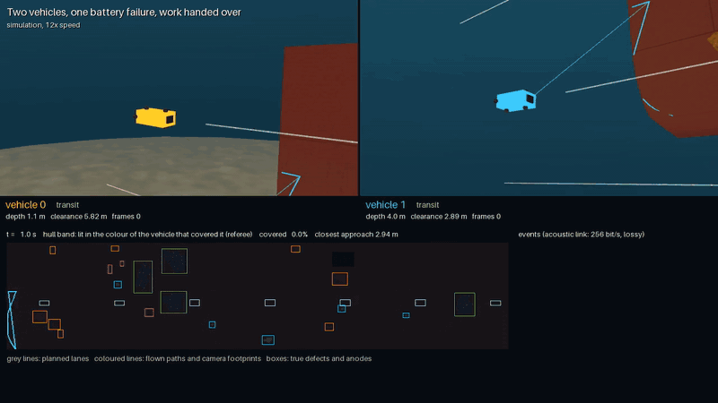

# Fleet

Several vehicles inspect one hull together, coordinated over a slow, lossy acoustic link.

## Sharing the hull

`auvinspect fleet` ([`fleet.py`](../src/auvinspect/fleet.py)) flies several vehicles over one hull on
one clock:
- **Sharing.** The planned lanes are split into contiguous groups, one per vehicle. Each vehicle
  flies every lane in the direction the whole plan flies it, so the vehicles move in step. Every
  lane still ends past the hull ends, where the vehicle fixes its along-ship position. A vehicle
  answers for the girth band up to the midpoints to its neighbours' lanes, and its revisits
  target holes there only.
- **One clock.** The mission advances one control tick per step, so all vehicles fly at once
  under the same physics, navigation and faults as a single mission. A fleet of one is the
  single-vehicle mission, byte for byte. Each vehicle writes its own frames, events and metrics
  (`v<k>/`).
- **Fleet referee.** One referee takes every vehicle's frames. It reports the fleet's coverage, the
  union of the vehicles' claims against the truth, the makespan, and the closest approach between
  two vehicles, with the ticks under `fleet.min_separation_m` (1 m).

On the default 20 m hull (seed 7, simulation results):

| Vehicles | Makespan | Speed-up | Coverage | Claimed, false claims | Closest approach |
|---|---|---|---|---|---|
| 1 | 352.8 s | 1 | 100% | 100%, 0 | n/a |
| 2 (2 lanes each) | 175.9 s | 2.0 | 100% | 100%, 0 | 2.79 m |
| 4 (1 lane each) | 87.3 s | 4.0 | 100% | 100%, 0 | 1.31 m, never under 1 m |

With one lane each, neighbours fly opposite ways and pass a lane's spacing apart. With two lanes
each, they move the same way, two lanes apart.



*Vehicle 1's battery fails at 100 s; the topside hands its unflown lane to vehicle 0, which flies it once its own lanes are done. [Full video, 6× speed (MP4)](media/fleet.mp4)*

## Coordination over an acoustic link

The vehicles and a topside station on the ship's side share one acoustic channel
([`acoustics.py`](../src/auvinspect/acoustics.py)):
- **The channel.** Nodes transmit in turn in 2 s slots, at 256 bit/s, so a vehicle sends about 48
  bytes every 6 s in a fleet of two. Packets arrive after their time on the air plus the sound's
  travel, and each receiver loses one with a chance that grows with range (10% plus 20% per
  100 m).
- **Reliable messages.** Lane done, finished, abort, assign and release are acknowledged and
  resent until they are, up to 10 times. Status reports and the topside's heartbeat are not.
- **What the vehicles say.** A vehicle reports each lane it finishes, that it has finished (then
  holds its position), or that it is aborting, with the lanes it has done.
- **The topside's job.** It hands an aborted vehicle's unfinished lanes, with their girth band, to
  a vehicle done with its own, and releases the vehicles when no one is still working.

The rules keep the vehicles apart without anyone knowing where the others are:
- **Only an abort frees lanes.** Silence never does: the topside cannot know where a silent vehicle
  is. It flags the vehicle and waits until 120 s past its planned finish, and the vehicle's data
  is read when it is recovered. A holding vehicle that has not heard the topside's heartbeat for
  30 s takes its link as lost and ends its mission where it is.
- **Own work first, on a clear path.** A vehicle takes over lanes only once its own are done, and
  only when no vehicle whose share lies between it and the work is still working, so its transit
  crosses no one.
- **Wait where no one works.** With whole-lane shares, a vehicle waits where it is, in its own
  girth band. With stretches (below), it waits in the middle of its stretch, at the standoff. Its
  last lane ended at a stretch boundary, where a neighbour may still be revisiting; waiting there
  brought two vehicles within 0.05 m. Revisits stay within each vehicle's own stretch.
- **Climb clear.** An aborting vehicle moves 2 m farther off the hull before it climbs to the
  surface. The others fly at the standoff, and the climb crosses their lanes; the topside's
  transducer hangs farther out still. Climbing at the standoff had brought two vehicles 1.08 m
  apart on the small hull. Off the hull's bottom, moving out means moving towards the seabed, so
  the vehicle moves no farther than its DVL altitude less 1 m allows: moving out there in full had
  put a vehicle on the seabed.

On the default 20 m hull with two vehicles (seed 7, simulation results):

| Case | Coverage | Lanes not flown, flown twice | Makespan | Closest approach |
|---|---|---|---|---|
| Nominal, coordinated | 100% | none, none | 175.9 s (released at 180.7 s) | 2.79 m |
| Vehicle 1's battery fails at 100 s, no coordination | 89.5% | lane 3, none | 175.1 s | 2.08 m |
| The same, coordinated | 100% | none, none | 274.5 s: vehicle 0 is handed lane 3 when its own are done (176.6 s) | 2.79 m |
| Vehicle 1's modem dies at 30 s | 100% | none, none | 175.9 s; vehicle 0 released at 311.5 s | 2.79 m |

The coordinated nominal fleet flies exactly as the uncoordinated one, and its link carries about
30 packets (about 320 bytes) per node. A fleet of one has no link: it is the single-vehicle mission.

## Stretches, and positioning from the ship

With `fleet.allocation: sections`, each vehicle
flies every lane over its own stretch of the hull. The stretches overlap 0.5 m, and the vehicles
move in step, a stretch apart. This allows more vehicles than lanes, but a middle stretch never
reaches a hull end, so its vehicle gets no along-ship fix from the sounder.

The ship's acoustic positioning (`acoustic.usbl`) supplies one. Whenever the topside hears a
vehicle, it measures where the vehicle was when it transmitted: 5 cm plus 1% of the range, per
axis. It sends that position back in its next slot. The vehicle shifts the fix by its own
estimated motion since then and fuses it, one scalar update per axis. On the 20 m hull with four
vehicles (simulation results):

| Start fix, ship positioning | Claimed by the fleet | Middle vehicles' along-ship error, max | Makespan | Closest approach |
|---|---|---|---|---|
| 5 cm, none | 100% | 0.06 m | 140.5 s | 4.0 m |
| 5 cm, on | 100% | 0.09 m | 140.7 s | 4.0 m |
| 1 m, none | 65%: the middle vehicles claim nothing | 0.40 m, 0.90 m | 185.5 s | 1.72 m |
| 1 m, on | 100% | 0.37 m, 0.90 m at the start; RMS 0.13 m, 0.26 m | 184.5 s | 2.24 m |

What this shows:
- **With a precise start, ship fixes are not needed.** With the 5 cm start the vehicles have by
  default, the DVL keeps every vehicle within 7 cm, and ship fixes, coarser than that, add a
  little noise.
- **With a realistic start, they are.** From a 1 m start, as a GPS fix at the surface gives, the
  middle vehicles cannot verify a single frame without them. With them, every vehicle verifies its
  stretch.
- **Whole lanes are faster on this hull.** Stretches finish in 140 s against 87 s, because of the
  extra turns. They pay off with more vehicles than lanes, or on long hulls.

The referee still counts the whole band covered without ship fixes: the overlaps absorb the drift.

## The fleet's report

The fleet directory holds the scenario's spec, so each `v<k>/` is a run,
and `merged/` is the whole fleet as one run: every vehicle's frames (prefixed `v<k>_`, linked, not
copied), the fleet referee's verdict and the union of the claims. Detection, the map, the station
check and the report run on it unchanged. The map's multi-view confirmation now draws on every
vehicle's frames, so a defect seen by two vehicles is confirmed by both. The report names the
fleet. The merged run counts as aborted only when planned lanes were left unflown.

## Fleet suites in the benchmark and CI

A suite with `fleet: true` is flown by a fleet (its
`overrides` set the fleet and per-vehicle faults), scored on the merged run, and adds the fleet's
values: closest approach, lanes not flown or flown twice, hand-overs and makespan. The `ci_fleet`
suite flies the two `ci` hulls with two vehicles, and vehicle 1's battery fails 50 s in. Its gate
requires both hand-overs, every lane flown, the vehicles at least 1 m apart, and the `ci` suite's
detection limits. CI flies and gates it after the `ci` suite.

| `ci_fleet` (2 hulls, simulation) | This machine's GPU | Software renderer, as on CI |
|---|---|---|
| Coverage, false claims | 100%, 0 | 100%, 0 |
| Hand-overs, lanes not flown, flown twice | 2, 0, 0 | 2, 0, 0 |
| Closest approach | 2.79 m | 2.79 m |
| Defects found (confirmed), precision | 86%, 100% | 83%, 92% |
| Stations right | 6 / 6 | 6 / 6 |

```bash
.venv/bin/auvinspect fleet --scenario runs/s7 --vehicles 2 --out runs/s7/fleet2      # --config: fleet.vehicle_faults
.venv/bin/auvinspect report --run runs/s7/fleet2/merged --out runs/s7/fleet2/report
.venv/bin/auvinspect benchmark run --suite ci_fleet --out runs/bench/ci_fleet
```
