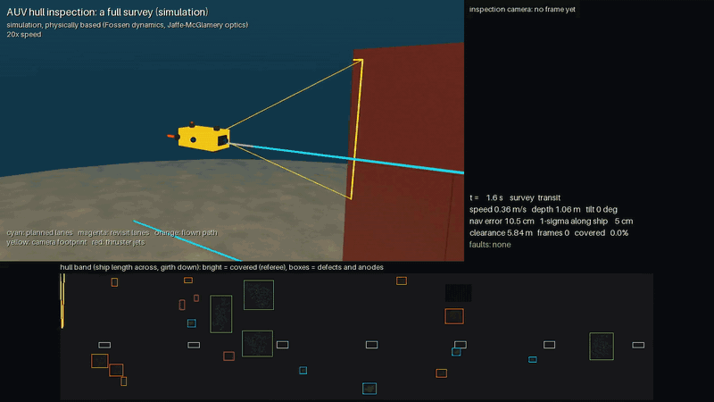
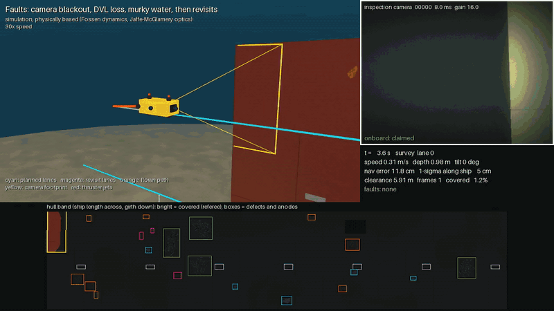

# Vehicle in the loop

The `mission` command flies the planned survey with a simulated vehicle: physics, sensors, navigation, control, faults, and the vehicle's own judgement of what it has covered.

*A full survey at 20× speed.*

- **Dynamics** ([`dynamics.py`](../src/auvinspect/dynamics.py)). The vehicle, a 0.5 x 0.3 x 0.2 m box
  with six thrusters, follows Fossen's marine-craft equations in the scenario's own world. The hull
  and seabed the camera sees are the ones it can touch and its DVL ranges against.
- **Navigation from sensors only.** [`auv_navigation_fusion`](https://github.com/MadLad10/auv-navigation-fusion)'s EKF fuses
  the simulated IMU, DVL, depth and compass. Two hull-relative updates are added. A standoff sounder
  on the camera tilt unit measures the range to the hull, which pins the distance from the hull and,
  with depth, the girth position. Lanes run past both hull ends, so the sounder's echo starts or
  stops where its beam crosses a hull end; each crossing is an along-ship position fix. If the echo
  is still there at a lane's planned end, the vehicle keeps going until it stops (edge search).
- **Guidance and control.** Paths are laid out on the hull at the survey standoff, so transits round
  the bilge keep that clearance too. A world-frame PID with drag feed-forward drives the vehicle; PD
  loops hold yaw and pitch. Thrust allocation is a pseudo-inverse of the thruster geometry. The tilt
  unit (rate-limited) faces the hull normal and cancels the measured roll. Frames are triggered when
  the vehicle, by its own estimate, reaches each planned frame position.
- **Faults** ([`faults.py`](../src/auvinspect/faults.py)): camera blackout, turbidity, DVL dropout,
  IMU bias, compass disturbance, stuck depth sensor, dead thruster, standoff-sounder dropout and
  battery loss, scheduled with onset and clear times and logged as ground truth. An empty battery
  drives no thruster.
- **Onboard health and safety.** The navigation filter's innovation gates reject a disturbed compass
  and readings inconsistent with the other sensors. A frozen-value check excludes the depth sensor
  while its readings repeat exactly (a live sensor always shows noise; a gate cannot see a sensor
  stuck at a plausible value). Below a battery reserve the vehicle abandons the mission and climbs
  along the hull at the standoff to the waterline, a path that keeps clear of the hull even from
  under the bilge.
- **Claimed coverage against the referee.** The vehicle judges each frame with the same image
  physics, from its estimated pose, the water its water-quality sensor measures, and the exposure
  and gain the camera used. A noiseless frame means a dead camera. Frames taken while the position
  uncertainty along the ship or the girth is above a limit count as seen but unverified; below it,
  each footprint shrinks by twice those uncertainties before it is claimed (on the hull extended
  past its ends and band, so only real edges shrink). The referee compares this claim with what the
  camera truly saw: a cell claimed but not seen is a false claim.
- **Replanning.** After the survey, unclaimed cells are clustered into holes. Each hole gets revisit
  lanes placed with the planner's own strip rules, for up to two rounds. Revisits are skipped while
  the vehicle's own position uncertainty is too large to claim anything.

On the full seed-7 hull the mission flies 96 frames in 353 s of simulated time (about three minutes
of wall-clock time). It covers 100% of the band, claims exactly that with no false claims, never
touches the hull and inspects all 27 items. The largest along-ship camera position error is 10 cm.

Fault cases on the 6 m test hull (seed 3, 19 items; blackout and turbidity from 100 to 120 s, inside
the last lane; DVL dropout from 60 to 120 s; simulation results):

*Seed 7 with a 25 s camera blackout, a 60 s DVL dropout and 20 s of 2 m visibility: 85.5% claimed after the survey (94.7% truly covered), 100% after the revisits, no false claims.*

| Run | After survey: true / claimed | After revisits: true / claimed | False claims | Largest along-ship error | Items inspected |
|---|---|---|---|---|---|
| Nominal | 100% / 100% | (none needed) | 0 | 0.05 m | 19 / 19 |
| Camera blackout, 20 s | 93.0% / 92.3% | 100% / 100% | 0 | 0.05 m | 19 / 19 |
| Turbidity (2 m visibility), 20 s | 93.0% / 92.3% | 100% / 100% | 0 | 0.05 m | 19 / 19 |
| DVL dropout, 60 s | 100% / 81.3% | 100% / 100% | 0 | 0.68 m | 19 / 19 |
| DVL dropout, 60 s, no hull-end fixes | 100% / 72.9% | revisits skipped (27% unverified) | 0 | 1.37 m | 19 / 19 |
| Stuck depth, compass offset 20°, gyro bias, sounder dropout, dead thruster | 100% / 100% | (none needed) | 0 | 0.05 m | 19 / 19 |
| 95% battery loss at 80 s | 82.0% / 81.0% | aborted, surfaced along the hull | 0 | 0.05 m | 13 / 19 |

In 2 m visibility the frames are milky haze: backscatter and forward scatter swamp the hull's
contrast, so no pixel reaches the contrast-to-noise limit. The vehicle measures the water and
agrees with the referee. During the DVL dropout the along-ship error grows by dead reckoning
(attitude noise leaks gravity into the accelerometer integration) until the next hull end, where
the edge search restores the fix; without hull-end fixes the vehicle cannot verify what it saw and
reports it as unverified. In the mixed-fault run the frozen-value check excludes the stuck depth
sensor 0.3 s after it freezes, keeping the girth error under 2 cm (22 cm without the check, while
the vehicle drifted on its buoyancy), and the filter rejects all compass readings while the
compass is disturbed.
