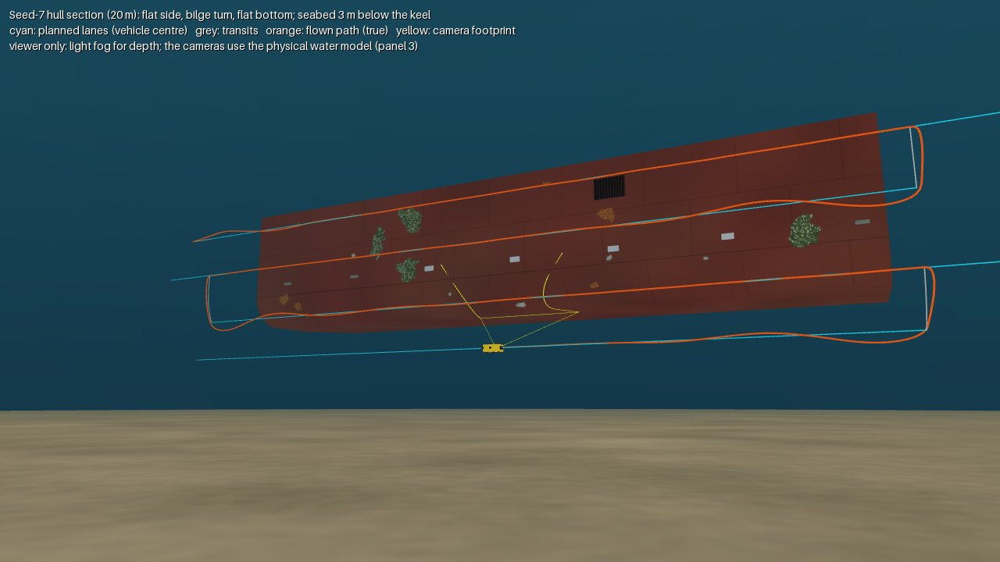
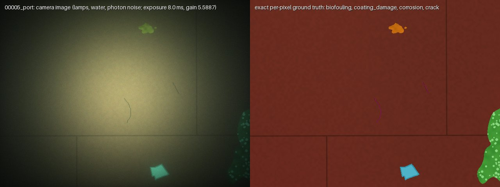
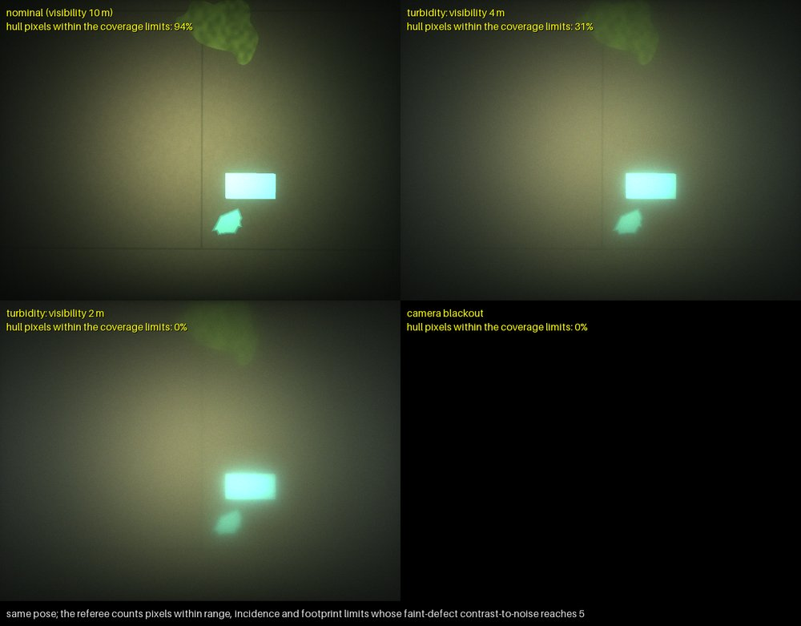
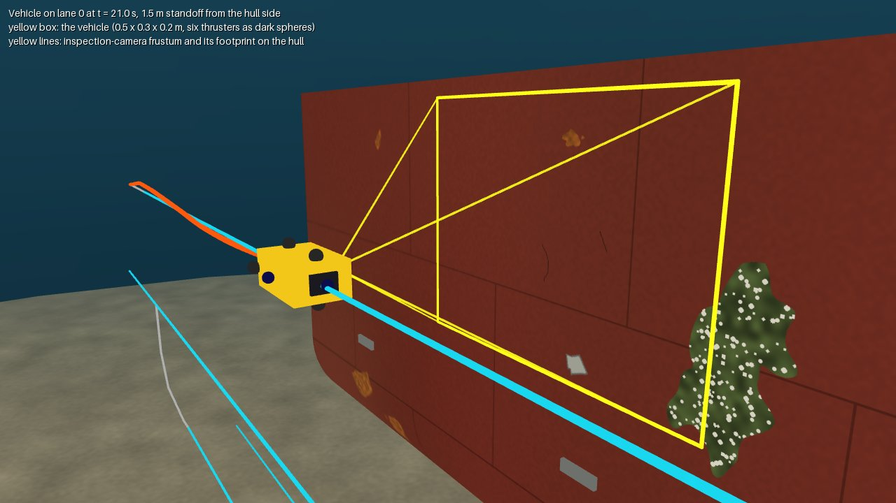

# Simulated world

The hull, its defects, the water, the cameras and the vehicle's physics, and the coverage referee that scores a survey against the exact ground truth. Every constant named here lives in [`config/default.yaml`](../src/auvinspect/config/default.yaml).

## Scenarios, images and coverage

- **Seeded hull scenarios.** A hull section (flat side, bilge turn, flat bottom) with painted plates
  and staggered weld seams, a slime film and a sea-chest grating as a decoy. Defects: corrosion,
  coating damage, biofouling with barnacles, cracks, and missing-anode footprints. Anodes are 3-D
  geometry, either intact or depleted. All sizes, counts and colours come from
  [`config/default.yaml`](../src/auvinspect/config/default.yaml).
- **Exact ground truth.** Defects live in a label raster on the hull's analytic surface coordinates
  (x along the ship, s down the girth). A rendered pixel's label comes from back-projecting its depth
  onto that surface, so labels do not depend on the render mesh.
- **Physically based underwater images** ([`optics.py`](../src/auvinspect/optics.py)). MuJoCo only
  rasterises geometry: depth, segmentation and unlit albedo. Two lamps on the camera's tilt unit
  light the hull through water described by its absorption, scattering and phase function. The
  image is direct light, forward-scattered light and backscatter, recorded by a sensor that counts
  photons, with auto exposure and white balance (see [Physics](simulation.md#physics)).
- **Survey planning against the referee's limits.** Lanes run back and forth at a fixed standoff;
  the inspection camera tilts to face the local hull normal. Each candidate lane's covered strip is
  computed on the curved hull with the same physics the referee uses, including midway between
  frames, and lanes are placed greedily with the requested overlap and a girth margin.
- **Coverage referee.** A 2 cm hull cell is covered when an inspection-camera pixel lands in it
  within the range, incidence and footprint limits and with a contrast-to-noise ratio that makes a
  faint defect detectable over the cell. A defect or anode counts as inspected when at least 80% of
  its area is covered.

With the default configuration (water visibility 10 m), seed 7 has 7 anodes, 8 corrosion patches,
5 coating-damage patches, 4 fouling patches and 3 cracks. The survey plans 4 lanes (96 frames),
covers 100% of the inspection band and inspects every item.

*One camera pose in 10 m, 4 m and 2 m visibility and with a dead camera: the share of hull pixels the coverage referee counts drops from 94% to 31% to nothing.*

## Physics

### Water and light ([`optics.py`](../src/auvinspect/optics.py))

Water is described per colour channel by its absorption a and scattering b (attenuation c = a + b)
and a Henyey-Greenstein phase function with asymmetry g = 0.924 (backscatter ratio about 0.018,
Petzold-like). Horizontal visibility is 4.8 / c (Zaneveld and Pegau 2003); a turbidity event scales
the particle scattering to a requested visibility. Each lamp radiates I(θ) = I0 cos^m θ about its
axis, with m from the half-power angle and I0 = P (m + 1) / 2π so its total power is P.

For a pixel seeing a Lambertian surface (albedo ρ, normal n) at range r, following Jaffe (1990) and
McGlamery (1980):

| Component | Model |
|---|---|
| Irradiance | Σ lamps I(θ) cos(i) / D² · e^(-cD) (1 + η (e^(bD) - 1)), plus optional daylight E_d(z) with diffuse attenuation; η is the scattered light that stays in a broad beam (HG power within 10°) |
| Direct | ρ E / π · e^(-cr) |
| Forward scatter | each surface pixel sends (e^(br) - 1) times its direct radiance into a single-scattering halo, computed from the phase function and the camera-surface geometry; the halo's share inside a 48-pixel kernel is convolved, the rest spread as a veil; energy is conserved |
| Backscatter | ∫ b p(ψ) Σ I(θ) / D² e^(-cD) e^(-cs) ds along the camera ray (single scattering from the lamps), integrated on every 16th ray (error below 0.1%), plus optional daylight veiling light |

### Camera ([`optics.py`](../src/auvinspect/optics.py), [`camera.py`](../src/auvinspect/camera.py))

Photo-electrons per second are L · π / (4N²) · cos⁴α · p² · QE · λ / (h c), for f-number N, pixel
pitch p, quantum efficiency QE and band centre λ. Auto exposure sets the exposure time (up to 8 ms,
which keeps motion blur under a pixel at survey speed) and then the gain so the centre-weighted mean
reaches its target. The image is Poisson shot noise, read noise, gain, white balance for the lamps
and 8-bit quantization, clipped at the full well; camera motion during the exposure blurs it.

The footprint of a pixel on the surface is exact: the larger singular value of the Jacobian of the
image-to-surface map, (Z / f) (e - q (n·e) / (n·q)) for the image axes e. A surface parallel to the
image has the same footprint, Z / f, in every pixel.

### Coverage criterion ([`coverage.py`](../src/auvinspect/coverage.py), [`predict.py`](../src/auvinspect/predict.py))

A pixel counts when it is within range, incidence and footprint limits, and when a faint defect (an
albedo step of 0.05 on hull paint) would reach a contrast-to-noise ratio of 5 over one 2 cm cell
(the Rose criterion). The signal is the unscattered direct light; the noise is the shot noise of
the paint's direct, forward-scattered and backscattered light, read noise and the quantization
step. The referee evaluates this per pixel from the render; the planner and the vehicle evaluate the
same function on the analytic hull from the pose, water and exposure they know.

### Vehicle ([`dynamics.py`](../src/auvinspect/dynamics.py), [`sensors.py`](../src/auvinspect/sensors.py))

(M_RB + M_A) ν̇ + C_RB(ν)ν + C_A(ν_r)ν_r + D(ν_r)ν_r + g(η) = τ_thrusters + τ_contact (Fossen 2011),
with ν_r the velocity relative to a uniform current and the current's frame rotation term included.

| Term | Model |
|---|---|
| M_RB | box of the configured mass, centre of gravity 4 cm below the centre of buoyancy |
| M_A | added mass and inertia of the ellipsoid with the box's volume and proportions (Lamb's coefficients) |
| C_RB, C_A | Sagatun-Fossen parametrisation (skew-symmetric, no work) |
| D | configured linear damping plus quadratic drag from a drag coefficient on the box faces (strip theory) |
| g(η) | weight at the centre of gravity, buoyancy at the centre of buoyancy (reduced at the surface); trimmed 3 N positive in seawater |
| Thrusters | six, first-order lag and saturation; power from actuator-disk theory |
| Contact | spring-damper and Coulomb friction at 26 points of the box against the hull and the seabed |

Integration is fourth-order Runge-Kutta at 100 Hz; control and sensors run at 20 Hz. Sensors: IMU
(specific force, gyro bias random walk, AHRS attitude noise), a four-beam Janus DVL whose beams are
cast against the hull and the seabed, compass, pressure depth, the standoff sounder, a water-quality
sensor (attenuation and scattering), the tilt encoder, thruster telemetry and battery.
